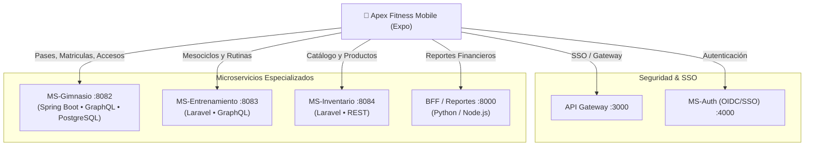

# 🏋️‍♂️ Apex Fitness Mobile — GymPulse Platform

<p align="center">
  
  
  
  
  
</p>

Aplicación móvil integral del ecosistema **Apex Fitness**, diseñada para smartphones Android e iOS con **React Native** y **Expo Router**. Conecta de forma distribuida con una arquitectura de microservicios empresariales para ofrecer gestión en sala, torniquete móvil de recepción y portal del socio con pase criptográfico dinámico.

---

## 🌟 Módulos y Roles del Sistema

### 1. 🏋️‍♂️ Portal del Socio (`/(client)`)
* **Pase Digital Criptográfico (QR Nativo):** Generación de token dinámico con renderizado matricial nativo sin dependencias de canvas HTML5, con *quiet zone* de alto contraste para lectura óptica instantánea en torniquetes.
* **Plan de Entrenamiento Semanal:** Visualización de mesociclos y rutinas asignadas desde `ms-entrenamiento` con selector de días, barra lineal de progreso y áreas táctiles de 48dp ergonómicas para sala de pesas.
* **Membresía en Tiempo Real:** Días restantes, fechas de vigencia, disciplina asignada y estado financiero consultado directamente a `ms-gimnasio`.
* **Historial y Rachas:** Registro de accesos con conteo de asistencia semanal.

### 2. 🛡️ Modo Torniquete & Recepción (`/(receptionist)`)
* **Lector Óptico de Acceso:** Uso de cámara física (`expo-camera CameraView`) para validar pases QR de socios en tiempo real.
* **Auto-Cierre de Alto Flujo:** Despacho y cierre automático del modal a los 2.5 segundos cuando el acceso es aprobado (`permitido: true`), evitando cuellos de botella en la entrada.
* **Auditoría de Acceso:** Persistencia de registros en la base de datos PostgreSQL de `ms-gimnasio`.
* **Controles Físicos:** Botón de linterna de alta respuesta y modo de ingreso manual por documento de identidad.

### 3. 👑 Panel Ejecutivo & IA (`/(admin)`)
* **KPIs y Métricas Diarias:** Asistentes en sala, picos de concurrencia, ingresos por membresías y tasa de retención.
* **Gráficas de Afluencia:** Análisis visual de distribución horaria de visitantes.
* **Edge AI Local:** Soporte para consultas y razonamiento asistido con base de conocimiento vectorial local.

---

## 🏛️ Arquitectura del Ecosistema

La aplicación interactúa con los siguientes microservicios:



---

## 🎨 Sistema de Diseño (UI / UX)

Diseñado estrictamente bajo las directrices de diseño corporativo compartido con la plataforma Web:

| Token | Código HEX | Propósito |
| :--- | :--- | :--- |
| **Forest Deep** | `#182228` | Fondo principal oscuro y de bajo consumo OLED |
| **Surface Elevated** | `#222D35` | Tarjetas interactivas y modales |
| **Sage Green** | `#90AB8B` | Color primario de marca, focos y confirmaciones |
| **Soft Cream** | `#EBF4DD` | Tipografía de alta legibilidad y jerarquía |
| **Amber Warning** | `#EAB308` | Alertas de acceso, linterna y badges de recepción |
| **Coral Danger** | `#DC2626` / `#F87171` | Accesos denegados y modal de cierre de sesión |

* **Componentes Exclusivos:**
  * `LogoutConfirmModal`: Popup modal con estética dark glass y botones ergonómicos de confirmación, reemplazando las alertas nativas planas del sistema.
  * `NativeQrMatrix`: Renderizador modular de códigos QR basado en vistas nativas vectoriales (100% funcional offline).

---

## 🚀 Requisitos Previos e Instalación

### Requisitos:
* **Node.js** v20.x o superior (Recomendado v24.x).
* **npm** o **yarn**.
* Aplicación **Expo Go** instalada en tu teléfono móvil (disponible en Google Play Store y App Store) o un emulador Android/iOS.

### 1. Clonar el repositorio
```bash
git clone https://github.com/TU_USUARIO/mobile_SW2_2doP.git
cd mobile_SW2_2doP
```

### 2. Instalar dependencias
```bash
npm install
```

### 3. Configurar variables de entorno
Copia la plantilla de entorno:
```bash
cp .env.example .env
```
Edita `.env` y coloca la **dirección IP local** de tu computadora en tu red Wi-Fi (ejemplo: `192.168.1.12`):
```env
EXPO_PUBLIC_SERVER_HOST=192.168.1.12
EXPO_PUBLIC_MS_GIMNASIO_GRAPHQL=http://192.168.1.12:8082/graphql
EXPO_PUBLIC_MS_ENTRENAMIENTO_GRAPHQL=http://192.168.1.12:8083/graphql
EXPO_PUBLIC_MS_AUTH_URL=http://192.168.1.12:4000
EXPO_PUBLIC_API_GATEWAY_URL=http://192.168.1.12:3000
```

---

## 📱 Ejecución de la Aplicación

Para iniciar el servidor de desarrollo de Metro Bundler:

```bash
npx expo start
```

* **En tu teléfono físico:** Abre la app **Expo Go** y escanea el código QR mostrado en la terminal.
* **En el navegador web:** Presiona la tecla `w`.
* **En emulador Android:** Presiona la tecla `a`.
* **Recargar la app:** Presiona la tecla `r`.

---

## 🔑 Cuentas de Acceso Rápido (Pruebas)

En la pantalla de bienvenida puedes ingresar manualmente o usar los chips de autocompletado rápido:

| Rol | Correo Electrónico | Contraseña | Destino |
| :--- | :--- | :--- | :--- |
| **👑 Administrador** | `admin@apexfitness.com` | `Password123!` | `/(admin)` Panel Ejecutivo |
| **📋 Recepcionista** | `recepcion@apexfitness.com` | `Password123!` | `/(receptionist)` Torniquete |
| **🏋️ Socio (Cliente)** | `cliente@apexfitness.com` | `Password123!` | `/(client)` Carnet QR y Rutina |

---

## 📁 Estructura del Proyecto

```text
mobile_SW2_2doP/
├── assets/                    # Iconos, splash screens e imágenes
├── src/
│   ├── app/                   # Enrutamiento basado en archivos (Expo Router)
│   │   ├── (admin)/           # Pantallas del Administrador (Dashboard, Chat IA, Settings)
│   │   ├── (client)/          # Pantallas del Socio (Carnet QR, Rutinas, Asistencias)
│   │   ├── (receptionist)/    # Pantallas de Recepción (Cámara Torniquete, Ingreso Manual)
│   │   ├── login.tsx          # Pantalla de Login unificada
│   │   └── _layout.tsx        # Layout raíz y guardas de autenticación
│   ├── components/            # Componentes modulares
│   │   ├── charts/            # Tarjetas de métricas y gráficos SVG
│   │   ├── common/            # Modales compartidos (LogoutConfirmModal, etc.)
│   │   └── chat/              # Widgets para asistente de IA
│   ├── constants/             # Tokens de diseño y colores corporativos (theme.ts)
│   ├── context/               # Proveedor de estado global (AuthContext.tsx)
│   ├── services/              # Clientes de microservicios
│   │   ├── bff/               # Cliente HTTP para métricas y reportes
│   │   ├── client/            # Consumo de membresías y rutinas
│   │   ├── config/            # Endpoints y resolución dinámica de host
│   │   ├── graphql/           # Cliente fetchGraphQL para Spring Boot y Laravel
│   │   └── reception/         # Validación de torniquete y accesos
│   └── types/                 # Definiciones de TypeScript
├── .env.example               # Plantilla de variables de entorno
├── .gitignore                 # Filtros de exclusión para Git
├── app.json                   # Configuración del proyecto Expo
├── package.json               # Dependencias del proyecto
└── tsconfig.json              # Configuración del compilador TypeScript
```

---

## 👥 Autores y Licencia

Desarrollado para el sistema **Apex Fitness Platform** (Software 2). Distribuido bajo licencia MIT.
